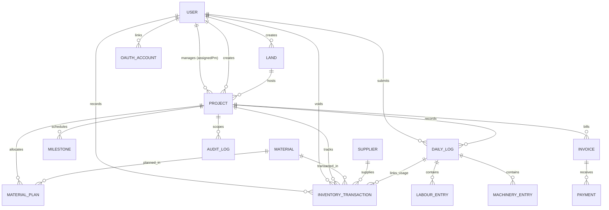

# ForgeOS — Relational Database Normalization Analysis

This document provides a rigorous, formal normalization breakdown of the **ForgeOS** construction ERP relational schema. It traces the database design from an **Unnormalized Form (UNF)** paper-based site register through **First Normal Form (1NF)**, **Second Normal Form (2NF)**, **Third Normal Form (3NF)**, and **Boyce-Codd Normal Form (BCNF)**.

---

## 1. Relational Schema & Notational Conventions

* **Relation Scheme:** $R(A_1, A_2, \dots, A_n)$
* **Primary Key (PK):** Underlined attribute, e.g., $\underline{\text{id}}$
* **Foreign Key (FK):** Italicized attribute with reference, e.g., $\textit{projectId} \to \text{Project}(\text{id})$
* **Candidate Key (CK):** Minimal superkey capable of uniquely identifying any tuple in $R$.
* **Functional Dependency (FD):** $X \to Y$ asserts that attribute set $X$ uniquely determines attribute set $Y$.
* **Prime Attribute:** An attribute that belongs to at least one candidate key of $R$.
* **Non-Prime Attribute:** An attribute that does not belong to any candidate key of $R$.

---

## 2. The Unnormalized State (UNF): The Legacy Construction Register

In traditional Indian construction site administration, daily work, material delivery, labour, and subcontractor billing are captured on a physical paper register or monolithic spreadsheet. 

### Monolithic Unnormalized Relation
$$\text{UNF\_SiteRegister}(\underline{\text{ProjectCode}}, \text{ProjectName}, \text{PM\_Name}, \text{PM\_Email}, \text{LandSurveyNo}, \text{LandCity}, \text{LandCost}, \{\text{LogDate}, \text{ProgressPct}, \{\text{WorkerTrade}, \text{HeadCount}, \text{Hours}\}, \{\text{MachineName}, \text{HoursUsed}\}\}, \{\text{MaterialName}, \text{Category}, \text{PlannedQty}, \{\text{TxnDate}, \text{TxnType}, \text{VendorName}, \text{VendorPhone}, \text{Qty}, \text{Rate}\}\}, \{\text{InvoiceNo}, \text{Amount}, \text{GST}, \{\text{PaymentDate}, \text{AmountPaid}, \text{Method}\}\})$$

### Anomalies Inherent in UNF:
1. **Insertion Anomaly:** A new supplier or raw material (e.g., Tata Tiscon TMT Steel) cannot be registered in the catalog without actively purchasing it for an existing building project.
2. **Deletion Anomaly:** If a project is completed and its historical logs are archived/purged, vendor contact details, land surveyor numbers, and equipment usage history are permanently lost.
3. **Update Anomaly:** If a supplier's phone number or a cement unit price changes, hundreds of manual duplicate rows must be updated. Any omission yields immediate data inconsistency.

---

## 3. First Normal Form (1NF)

### 1NF Definition
> A relation $R$ is in **First Normal Form (1NF)** if and only if all underlying domains contain only **atomic (indivisible) values**, and there are **no repeating groups or multi-valued arrays**.

### Transformation Steps from UNF to 1NF:
1. **Eliminate Nested Arrays & Repeating Groups:** Multi-valued fields (e.g., multiple workers on a daily log, multiple material deliveries) are flattened into individual relational records.
2. **Ensure Atomic Domains:** 
   * Land addresses are atomized into `addressLine`, `city`, `state`, and `pincode`.
   * Area measurements are split into `areaValue` (Numeric) and `areaUnit` (Enum: `SQFT`, `SQYD`, `SQM`, `ACRE`).
   * Material stock transactions are separated into atomic numeric units and transaction types.
3. **Define Definitive Primary Keys:** Surrogate keys (UUID/CUID) are assigned to uniquely identify every atomic entity record.

---

## 4. Second Normal Form (2NF)

### 2NF Definition
> A relation $R$ is in **Second Normal Form (2NF)** if and only if it is in **1NF** and **every non-prime attribute is fully functionally dependent on the entire primary key** (i.e., no non-prime attribute depends on a proper subset of any candidate key; **no partial functional dependencies**).

### Decomposition of Composite Keys:

#### Case Study: Material Planning & Stock Allocation
* In 1NF, a composite relation might exist:
  $$R_1(\underline{\text{projectId}, \text{materialId}}, \text{projectName}, \text{projectBudget}, \text{materialName}, \text{materialUnit}, \text{plannedQuantity}, \text{unitRate})$$
* Functional Dependencies:
  * $FD_1: \{\text{projectId}, \text{materialId}\} \to \{\text{plannedQuantity}, \text{unitRate}\}$ (Full dependency)
  * $FD_2: \{\text{projectId}\} \to \{\text{projectName}, \text{projectBudget}\}$ (**Partial dependency on proper subset!**)
  * $FD_3: \{\text{materialId}\} \to \{\text{materialName}, \text{materialUnit}\}$ (**Partial dependency on proper subset!**)
* **2NF Resolution:** Decompose $R_1$ into three distinct relations:
  1. $\text{Project}(\underline{\text{id}}, \text{name}, \text{totalBudget}, \dots)$
  2. $\text{Material}(\underline{\text{id}}, \text{name}, \text{unit}, \dots)$
  3. $\text{MaterialPlan}(\underline{\text{id}}, \textit{projectId}, \textit{materialId}, \text{plannedQuantity}, \text{unitRate}, \dots)$ where Candidate Key is $\{\text{projectId}, \text{materialId}\}$.

#### Case Study: Daily Construction Logs & Labour Entries
* In 1NF, logging labour on site daily produces:
  $$R_2(\underline{\text{dailyLogId}, \text{trade}}, \text{logDate}, \text{progressPercent}, \text{headCount}, \text{hoursWorked})$$
* Functional Dependencies:
  * $FD_1: \{\text{dailyLogId}, \text{trade}\} \to \{\text{headCount}, \text{hoursWorked}\}$
  * $FD_2: \{\text{dailyLogId}\} \to \{\text{logDate}, \text{progressPercent}\}$ (**Partial dependency!**)
* **2NF Resolution:** Decompose $R_2$ into:
  1. $\text{DailyLog}(\underline{\text{id}}, \textit{projectId}, \text{logDate}, \text{progressPercent}, \dots)$
  2. $\text{LabourEntry}(\underline{\text{id}}, \textit{dailyLogId}, \text{trade}, \text{headCount}, \text{hoursWorked}, \dots)$

All relations in ForgeOS now have non-prime attributes fully dependent on their candidate keys, satisfying **2NF**.

---

## 5. Third Normal Form (3NF)

### 3NF Definition
> A relation $R$ is in **Third Normal Form (3NF)** if and only if it is in **2NF** and **no non-prime attribute is transitively dependent on any candidate key**.
> Formally, for every non-trivial functional dependency $X \to A$, either:
> 1. $X$ is a **superkey** of $R$, OR
> 2. $A$ is a **prime attribute** (member of a candidate key).

### Transitive Dependency Eliminations:

#### Case 1: Land Ownership and Site Location
* Candidate relation before 3NF:
  $$\text{Project}(\underline{\text{id}}, \text{name}, \text{status}, \textit{landId}, \text{surveyNumber}, \text{landCity}, \text{landState}, \text{landArea}, \text{landOwner})$$
* Functional Dependencies:
  * $FD_1: \text{id} \to \{\text{name}, \text{status}, \text{landId}\}$
  * $FD_2: \text{landId} \to \{\text{surveyNumber}, \text{landCity}, \text{landState}, \text{landArea}, \text{landOwner}\}$
  * Transitive Dependency: $\text{id} \to \text{landId} \to \{\text{surveyNumber}, \text{landCity}, \dots\}$
* **3NF Decomposition:**
  * $\text{Land}(\underline{\text{id}}, \text{surveyNumber}, \text{city}, \text{state}, \text{areaValue}, \text{areaUnit}, \text{ownerName}, \dots)$
  * $\text{Project}(\underline{\text{id}}, \text{name}, \text{status}, \textit{landId}, \dots)$
  * *Result:* $\text{landId}$ is an FK referencing $\text{Land}(\text{id})$. If land details change, only one row in $\text{Land}$ is modified.

#### Case 2: Invoices, Payments, and Billing Reconciliation
* Candidate relation before 3NF:
  $$\text{Payment}(\underline{\text{id}}, \textit{invoiceId}, \text{amount}, \text{method}, \text{invoiceDueDate}, \text{invoiceGstPct}, \textit{projectId})$$
* Functional Dependencies:
  * $FD_1: \text{id} \to \{\text{invoiceId}, \text{amount}, \text{method}\}$
  * $FD_2: \text{invoiceId} \to \{\text{invoiceDueDate}, \text{invoiceGstPct}, \text{projectId}\}$
  * Transitive Dependency: $\text{id} \to \text{invoiceId} \to \{\text{invoiceDueDate}, \dots\}$
* **3NF Decomposition:**
  * $\text{Invoice}(\underline{\text{id}}, \text{invoiceNo}, \textit{projectId}, \text{amount}, \text{gstPct}, \text{status}, \text{dueDate}, \dots)$
  * $\text{Payment}(\underline{\text{id}}, \textit{invoiceId}, \text{amount}, \text{method}, \text{reference}, \text{paidAt})$

#### Case 3: Inventory Transactions and Vendor Registry
* Candidate relation before 3NF:
  $$\text{InventoryTransaction}(\underline{\text{id}}, \textit{projectId}, \textit{materialId}, \textit{vendorId}, \text{vendorName}, \text{vendorPhone}, \text{quantity}, \text{txnType})$$
* Transitive Dependency: $\text{id} \to \text{vendorId} \to \{\text{vendorName}, \text{vendorPhone}\}$
* **3NF Decomposition:**
  * $\text{Supplier}(\underline{\text{id}}, \text{name}, \text{phone}, \text{email}, \text{address})$
  * $\text{InventoryTransaction}(\underline{\text{id}}, \textit{projectId}, \textit{materialId}, \textit{vendorId}, \text{txnType}, \text{quantity}, \dots)$

---

## 6. Boyce-Codd Normal Form (BCNF)

### BCNF Definition
> A relation $R$ is in **Boyce-Codd Normal Form (BCNF)** if and only if **for every non-trivial functional dependency $X \to Y$, $X$ is a superkey**.
> BCNF is a stricter version of 3NF that handles edge cases where multiple overlapping composite candidate keys exist.

### BCNF Verification Across Entities:

#### 1. Relation `MaterialPlan`
* Attributes: $\{\underline{\text{id}}, \textit{projectId}, \textit{materialId}, \text{openingQuantity}, \text{plannedQuantity}, \text{status}, \dots\}$
* Candidate Keys:
  * $CK_1 = \{\text{id}\}$
  * $CK_2 = \{\text{projectId}, \text{materialId}\}$ (Enforced by `@@unique([projectId, materialId])`)
* Functional Dependencies:
  * $FD_1: \text{id} \to \{\text{projectId}, \text{materialId}, \text{plannedQuantity}, \dots\}$ (LHS is $CK_1$ — Superkey ✅)
  * $FD_2: \{\text{projectId}, \text{materialId}\} \to \{\text{id}, \text{plannedQuantity}, \dots\}$ (LHS is $CK_2$ — Superkey ✅)
* **Conclusion:** Every determinant is a superkey. **Satisfies BCNF.**

#### 2. Relation `DailyLog`
* Attributes: $\{\underline{\text{id}}, \textit{projectId}, \text{logDate}, \text{progressPercent}, \text{workSummary}, \dots\}$
* Candidate Keys:
  * $CK_1 = \{\text{id}\}$
  * $CK_2 = \{\text{projectId}, \text{logDate}\}$ (Enforced by `@@unique([projectId, logDate])`)
* Functional Dependencies:
  * $FD_1: \text{id} \to \{\text{projectId}, \text{logDate}, \text{progressPercent}, \dots\}$ (LHS is Superkey ✅)
  * $FD_2: \{\text{projectId}, \text{logDate}\} \to \{\text{id}, \text{progressPercent}, \dots\}$ (LHS is Superkey ✅)
* **Conclusion:** Satisfies BCNF.

#### 3. Relation `OAuthAccount`
* Attributes: $\{\underline{\text{id}}, \text{provider}, \text{providerAccountId}, \textit{userId}, \text{createdAt}\}$
* Candidate Keys:
  * $CK_1 = \{\text{id}\}$
  * $CK_2 = \{\text{provider}, \text{providerAccountId}\}$ (Enforced by `@@unique([provider, providerAccountId])`)
* Functional Dependencies:
  * $FD_1: \text{id} \to \{\text{provider}, \text{providerAccountId}, \text{userId}\}$ (LHS is Superkey ✅)
  * $FD_2: \{\text{provider}, \text{providerAccountId}\} \to \{\text{id}, \text{userId}\}$ (LHS is Superkey ✅)
* **Conclusion:** Satisfies BCNF.

---

## 7. Normalization Audit Matrix (All 17 Entities)

| # | Entity Name | Primary Key | Alternate Candidate Keys | Foreign Keys | Normal Form | Highest Justification |
|---|---|---|---|---|:---:|---|
| 1 | **User** | `id` | `email` | None | **BCNF** | All determinants (`id`, `email`) are candidate keys. |
| 2 | **OAuthAccount** | `id` | `{provider, providerAccountId}` | `userId` | **BCNF** | Strict surrogate + natural candidate key. |
| 3 | **OtpCode** | `id` | None | None | **BCNF** | Simple functional dependency from PK. |
| 4 | **Land** | `id` | None | `createdById` | **BCNF** | No transitive or partial dependencies. |
| 5 | **Project** | `id` | `code` | `landId`, `assignedPmId`, `createdById` | **BCNF** | `id` and `code` (e.g. `FOS-001`) are unique superkeys. |
| 6 | **Supplier** | `id` | None | None | **BCNF** | Single surrogate candidate key. |
| 7 | **Material** | `id` | `name` | None | **BCNF** | Catalog entity; `id` and `name` are candidate keys. |
| 8 | **MaterialPlan** | `id` | `{projectId, materialId}` | `projectId`, `materialId`, `createdById` | **BCNF** | Both determinants are candidate superkeys. |
| 9 | **InventoryTransaction** | `id` | None | `projectId`, `materialId`, `vendorId`, `dailyLogId`, `recordedById`, `voidedById` | **BCNF** | Append-only ledger; all non-prime attrs depend on `id`. |
| 10 | **DailyLog** | `id` | `{projectId, logDate}` | `projectId`, `createdById` | **BCNF** | Natural key `{projectId, logDate}` prevents duplicates. |
| 11 | **LabourEntry** | `id` | None | `dailyLogId` | **BCNF** | Weak entity fully partitioned by surrogate ID. |
| 12 | **MachineryEntry** | `id` | None | `dailyLogId` | **BCNF** | Equipment log dependent on parent `DailyLog`. |
| 13 | **Milestone** | `id` | None | `projectId` | **BCNF** | Sequence and progress dependent solely on `id`. |
| 14 | **Invoice** | `id` | `invoiceNo` | `projectId` | **BCNF** | Both `id` and `invoiceNo` (e.g. `INV-2026-001`) are CKs. |
| 15 | **Payment** | `id` | None | `invoiceId` | **BCNF** | Payments depend on surrogate `id`. |
| 16 | **AuditLog** | `id` | None | `projectId` | **3NF/BCNF** | Write-once append log; JSON `meta` attribute used for audit delta. |

---

## 8. Theoretical Properties of the Decomposition

### 1. Lossless-Join Decomposition
A decomposition of relation $R$ into $R_1$ and $R_2$ is **lossless** with respect to a set of functional dependencies $F$ if:
$$R_1 \cap R_2 \to R_1 \quad \text{or} \quad R_1 \cap R_2 \to R_2$$
In ForgeOS, every split relation shares its primary key as a foreign key in the child relation:
* $\text{Project} \cap \text{MaterialPlan} = \{\text{projectId}\} \to \text{Project}$ (Superkey of Project).
* Therefore, performing an `INNER JOIN` or `LEFT JOIN` between `Project` and `MaterialPlan` reconstructs the original relationship without generating spurious tuples.

### 2. Dependency Preservation
A decomposition is **dependency-preserving** if the union of functional dependencies enforceable on individual sub-relations covers all functional dependencies of the original schema:
$$F^+ = (F_1 \cup F_2 \cup \dots \cup F_k)^+$$
All functional dependencies (including unique constraints on project codes, invoice numbers, and composite unique keys like `{projectId, materialId}`) are enforced locally within individual relations via database `UNIQUE` constraints and foreign key triggers.

---

## 9. Architectural Denormalization Decisions (Engineering Trade-Offs)

While the entire transactional core is in **BCNF**, specific conscious engineering trade-offs were made:

1. **`AuditLog.meta` (JSONB / Text attribute):**
   * *Pure Relational Alternative:* An EAV (Entity-Attribute-Value) table with thousands of key-value pair rows.
   * *Engineering Decision:* Storing snapshot metadata as a serialized JSON string avoids complex 5-way joins for non-relational audit diffs while keeping write operations $O(1)$.
2. **Append-Only Inventory Ledger vs. `currentStock` column:**
   * *Standard 3NF approach:* Store an integer column `Material.currentStock` and update it on every receipt.
   * *ForgeOS Decision:* Inventory is derived from the append-only ledger `InventoryTransaction` ($Balance = Opening + \sum IN - \sum OUT$). This prevents race conditions and guarantees an un-tamperable audit trail for Indian real estate compliance.

---

## 10. Entity-Relationship Definition (Mermaid Specification)

